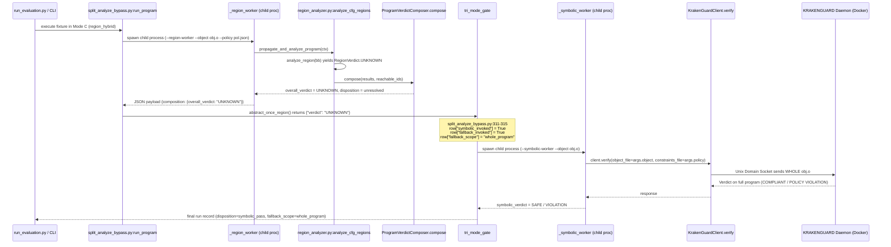

# Task 12 Phase 1: Region-Scoped Symbolic Fallback Design and Audit Report

**Document:** `REGION_SCOPED_FALLBACK_DESIGN.md`  
**Phase:** Phase 1 (Audit & Design) — *Implementation Deferred to Phase 2*  
**Date:** 2026-10-25  
**Authoritative Baseline:** Commit `ce2cebe` on branch `main`  
**Repository Working Directory:** `/home/cy3pher/Documents/WorkSpace-Research/eBPF`  

---

## 1. Executive Summary & Purpose

The objective of Task 12 is to audit, design, and implement the intended research architecture: **CFG-region abstract interpretation coupled with state-aware, region-scoped symbolic fallback**.

In strict accordance with user instructions, this document executes **Phase 1 (Audit and Design) only**. No implementation code was written during Phase 1. All existing benchmark datasets (`split_bypass_evaluation/`), Katran case-study results (`katran_case_study/`), policies, test suites, dissertation Word/PDF exports, and manuscript files remain completely unmodified and preserved.

### Primary Audit Findings:
1. **Actual Fallback Behavior in Current Implementation (`CONFIRMED FACT`):**
   - The current abstract analyzer in Mode C (`region_analyzer.py`) partitions programs into CFG regions and propagates abstract states with sound lattice joins ($\sqcup$).
   - When any reachable region is unresolved (`RegionVerdict.UNKNOWN`), the orchestration runner (`split_analyze_bypass.py` and `run_evaluation.py`) falls back by passing the **entire compiled eBPF ELF binary** to KRAKENGUARD.
   - The telemetry truthfully records `analyzer_scope: "region_level"` and `fallback_scope: "whole_program"`. There is currently no active connection routing an isolated region to a symbolic verifier.
2. **KRAKENGUARD Backend Architectural Blocker (`CONFIRMED FACT`):**
   - KRAKENGUARD's pipeline (`generateIR.py` $\to$ `bpflifter_cli` $\to$ `krakenguard_template.j2` $\to$ KLEE) requires a full ELF file containing an entry function (`xdp_prog` or `bpf_prog`) and generates a C driver calling that function with symbolic whole-context structs (`struct xdp_md` or `struct pt_regs`).
   - KRAKENGUARD **cannot** ingest an isolated sequence of instructions or basic block, nor can it accept incoming register intervals or stack slots from an external abstract interpreter.
3. **Sound Region-Scoped Fallback Architecture (`DESIGN PROPOSAL`):**
   - To achieve genuine region-scoped fallback without fabricating ELF wrappers, we specify a formal `RegionSymbolicRequest` / `RegionSymbolicResponse` typed contract.
   - For backend execution, an in-memory state-aware SMT/interval symbolic engine (`DirectRegionSymbolicExecutor`) analyzes isolated instruction sequences under explicit abstract assumptions, tracking relational pointer provenance (`packet`, `map_val`, `stack`, `scalar`).
   - If KRAKENGUARD is used as a fallback backend, the system must truthfully report `fallback_scope: "whole_program"`. Only when an isolated region is verified under explicit incoming assumptions can `fallback_scope` be labeled `region_scoped`.

---

## 2. Audit of Existing Implementation

### 2.1 CFG Construction and Region Abstraction (`CONFIRMED FACT`)
*Source: `research/experiments/split_bypass/scripts/region_analyzer.py:100–430`*

- **Binary Disassembly:** `BpfProgramContext` disassembles the compiled eBPF ELF using `/usr/bin/llvm-objdump -d --no-show-raw-insn --print-imm-hex`.
- **Basic Block Partitioning:** Instructions are partitioned into basic blocks by identifying leaders:
  1. Entry instruction (PC 0).
  2. Any instruction that is the target of a conditional or unconditional jump.
  3. Any instruction immediately following a jump, call, or return instruction.
- **CFG Regions:** A `RegionBoundary` encapsulates one or more basic blocks with explicit entry and exit block IDs. In the default configuration, each basic block forms a single-block region (`ScopeLevel.BASIC_BLOCK`).
- **Initial Abstract State:** At program entry (PC 0):
  - Register `r1` is initialized to `AbstractValue.symbolic("ctx")` with provenance `packet`.
  - Register `r10` is initialized to `AbstractValue.symbolic("fp")` with provenance `stack`.
  - Registers `r2..r9, r0` are initialized to `AbstractValue.unknown()` with provenance `scalar`.

### 2.2 Intra-Region Transfer Functions (`CONFIRMED FACT`)
*Source: `research/experiments/split_bypass/scripts/region_analyzer.py:430–840`*

- **32-Bit and 64-Bit ALU:** ALU operations (`add`, `sub`, `mov`, `and`, `or`, etc.) are modeled with interval arithmetic and constant folding. 32-bit operations (`wX = ...`) clear upper 32 bits and evaluate over the `[0, 2^{32}-1]` domain.
- **Stack Memory Modeling:** `r10` offsets are bounds-checked within `[-512, 0)`. Stores record slot offset, byte width (`u8`, `u16`, `u32`, `u64`), and abstract value. Overlapping slot writes invalidate prior sub-slots.
- **Helper Function Calls:** Modeled helpers (e.g., `bpf_ktime_get_ns`, `bpf_map_lookup_elem`) update `r0` and clobber caller-saved registers `r1..r5`. Forbidden helpers immediately yield `RegionVerdict.VIOLATION`. Unmodeled helpers immediately yield `RegionVerdict.UNKNOWN`.
- **Pointer Provenance Gap in Legacy Analyzer:** The legacy analyzer (`abstract_policy_analyzer.py`) flagged *any* memory write instruction matching `*(uX *)(rY + off) = ...` as a potential packet write violation. In contrast, `region_analyzer.py` checks whether the base register is `r10` (stack write = safe) vs other registers. However, writes to map values (e.g., `*(u32 *)(r0 + 0) = ...` following `bpf_map_lookup_elem`) were still treated as `UNKNOWN` or potential violations due to lack of relational map provenance.

### 2.3 Inter-Region State Propagation and Joins (`CONFIRMED FACT`)
*Source: `research/experiments/split_bypass/scripts/region_analyzer.py:940–1048`*

- **Worklist Propagation:** `analyze_cfg_regions` iterates over reachable regions using a worklist algorithm initialized with the entry region.
- **Lattice Join ($\sqcup$):** When multiple predecessors target the same region, their exit states are joined:
  - Registers: `val1.join(val2)` takes the least upper bound (identical constants $\to$ constant; diverging constants $\to$ bounded interval; unboundable $\to$ unknown).
  - Path constraints: Intersection of predecessor constraints ($\mathcal{C}_1 \cap \mathcal{C}_2$).
  - Stack assumptions: Slot-by-slot join. If width matches, abstract values are joined; if widths mismatch or slot is absent in one predecessor, the slot is invalidated.
- **Cycle / Loop Handling:** CFG back-edges are detected during depth-first traversal. When a region is identified as a back-edge target, it is immediately marked `RegionVerdict.UNKNOWN` with reason `"CFG cycle / back-edge detected"`, preventing infinite analysis loops.
- **Verdict Composition:** `ProgramVerdictComposer.compose` evaluates all reachable region results:
  - Any reachable `VIOLATION` $\to$ overall `VIOLATION` (early exit).
  - Any reachable `UNKNOWN` $\to$ overall `UNKNOWN`.
  - All reachable regions `SAFE` $\to$ overall `SAFE`.

---

## 3. Trace of Exactly How UNKNOWN Triggers Whole-Program Fallback

### 3.1 Step-by-Step Execution Trace (`CONFIRMED FACT`)

The exact call chain through which an unresolved region triggers whole-program fallback in the existing repository is as follows:



### 3.2 Code Evidence from Source Code (`CONFIRMED FACT`)

1. **`region_analyzer.py:983–991`:**
   ```python
   # Analyze region
   res = analyze_region(program, region, curr_in_state)
   region_results[rid] = res

   if res.verdict == RegionVerdict.VIOLATION:
       continue

   if res.verdict == RegionVerdict.UNKNOWN:
       continue  # Region remains UNKNOWN; no fallback invoked here
   ```
2. **`region_analyzer.py:1043–1046` & `region_contract.py:288–300`:**
   ```python
   # Compose final whole-program verdict
   composition = ProgramVerdictComposer.compose(
       results=list(region_results.values()),
       reachable_region_ids=reachable_region_ids,
   )
   # Inside compose():
   unresolved = [rid for rid in reachable_region_ids if results_by_id[rid].verdict == RegionVerdict.UNKNOWN]
   if unresolved:
       return {
           "overall_verdict": RegionVerdict.UNKNOWN.value,
           "disposition": "unresolved",
           "reason": f"Reachable regions unresolved: {dict(zip(unresolved, reasons))}",
           "soundly_discharged": False,
       }
   ```
3. **`split_analyze_bypass.py:537–545`:**
   ```python
   payload = json.loads(proc.stdout.strip().splitlines()[-1])
   region_holder.update(payload)
   composition = payload.get("composition", {})
   return {
       "verdict": composition.get("overall_verdict", "UNKNOWN"),
       "reason": composition.get("reason", ""),
       "composition": composition,
   }
   ```
4. **`split_analyze_bypass.py:311–320`:**
   ```python
   # Unresolved or error: Fallback to symbolic verification
   row["symbolic_invoked"] = True
   row["fallback_invoked"] = True
   row["fallback_scope"] = "whole_program"  # <--- HARDCODED WHOLE_PROGRAM

   if symbolic_runner is None:
       row["symbolic_error"] = "whole-program symbolic fallback unavailable"
       row["overall_verdict"] = "UNKNOWN"
       row["disposition"] = "unresolved"
       return row
   ```
5. **`split_analyze_bypass.py:438` & `555–563`:**
   ```python
   client = KrakenGuardClient(socket_path)
   response = client.verify(object_file=args.object, constraints_file=args.policy)
   # args.object is the full compiled eBPF ELF file!
   ```

---

## 4. KRAKENGUARD Backend Capabilities & Architectural Blockers

### 4.1 Pipeline Structure (`CONFIRMED FACT`)
*Source: `research/baselines/krakenguard/artifact/lifting_tools/generateIR.py:74–150`*

The KRAKENGUARD symbolic verification pipeline operates as follows:
```text
eBPF ELF (.o) 
    ──> bpflifter_cli (Decompiler.cpp) 
    ──> Raw LLVM IR (.ll) 
    ──> sanitize_lifted_ir.py (ALU32 load normalization) 
    ──> opt -O3 passes 
    ──> Jinja2 Template (krakenguard_template.j2) generates C driver 
    ──> clang generates driver bitcode 
    ──> llvm-link generates final_linked_ir.bc 
    ──> klee --search=dfs final_linked_ir.bc 
    ──> Policy Oracle (extract_krakenguard_verdict)
```

### 4.2 Concrete Architectural Blockers for Region Fallback via KRAKENGUARD (`CONFIRMED FACT`)

| Subsystem | Requirement for Region-Scoped Fallback | Actual KRAKENGUARD Implementation | Blocker Severity |
| :--- | :--- | :--- | :--- |
| **`bpflifter_cli`** | Lift an arbitrary instruction slice or basic block `[PC_start .. PC_end]`. | Requires an ELF binary with ELF headers, section headers (`.text`, `.maps`), and symbol table. Crashes or fails on raw byte buffers. | **FATAL BLOCKER** |
| **Harness Generation (`krakenguard_template.j2`)** | Accept arbitrary incoming register values `r0..r10` and stack memory frames. | Hardcodes entry call `int val = extern_func(&test)` where `test` is a freshly allocated `struct xdp_md` or `struct pt_regs`. Zero support for passing register states. | **FATAL BLOCKER** |
| **KLEE Driver** | Execute starting from an intermediate program point with pre-constrained symbolic variables. | Always starts execution from `main()` at line 1, executing the global entry point. | **FATAL BLOCKER** |
| **Daemon Protocol (`protocol.py`)** | Request schema specifying region PC bounds, register assumptions, and stack slots. | Request schema (`protocol.py:31–65`) only accepts `files: Dict[str, FileInfo]` (ELF binary + policy JSON) and `load_options`. | **FATAL BLOCKER** |

**Audited Verdict on KRAKENGUARD:** KRAKENGUARD cannot be repurposed as a region-scoped fallback backend without rewriting its C++ lifter, C harness generator, and daemon protocol. Any attempt to claim KRAKENGUARD provides "region-scoped" fallback while passing full ELF files violates scientific veracity.

---

## 5. Formal Region-Symbolic Request/Response Contract

To formalize the boundary between abstract interpretation and any state-aware symbolic executor, we define the typed contract specification.

### 5.1 `RegionSymbolicRequest` Contract (`PROPOSED DESIGN`)
*Defined in `research/experiments/split_bypass/scripts/region_contract.py:203–223`*

```python
@dataclass(frozen=True)
class RegionSymbolicRequest:
    """Formal contract request for state-aware, region-scoped symbolic fallback."""
    region_id: str                          # Identifier of the unresolved region (e.g. "bb_10")
    scope: ScopeLevel                        # Must be BASIC_BLOCK or MULTI_BLOCK_REGION
    instructions: tuple[Any, ...]            # Isolated instruction objects for this region only
    incoming_state: IncomingAbstractState    # Explicit abstract incoming state
    policy: Mapping[str, Any]                # Security policy specification
    entry_pc: int                            # Entry instruction PC
    exit_pcs: tuple[int, ...]                # Feasible exit PCs
    timeout_seconds: int = 30                # Bounded execution budget

    def __post_init__(self):
        if self.scope == ScopeLevel.WHOLE_PROGRAM:
            raise ValueError("RegionSymbolicRequest cannot have WHOLE_PROGRAM scope")
        if not self.instructions:
            raise ValueError("RegionSymbolicRequest instructions cannot be empty")
        if not self.incoming_state.is_explicit:
            raise ValueError("RegionSymbolicRequest requires an explicit incoming abstract state")
```

### 5.2 `RegionSymbolicResponse` Contract (`PROPOSED DESIGN`)
*Defined in `research/experiments/split_bypass/scripts/region_contract.py:225–248`*

```python
@dataclass(frozen=True)
class RegionSymbolicResponse:
    """Formal contract response from state-aware, region-scoped symbolic fallback."""
    region_id: str
    verdict: RegionVerdict                  # SAFE, VIOLATION, or UNKNOWN
    scope: ScopeLevel                        # Scope of the analyzed region
    backend_executor_scope: ScopeLevel       # Genuinely executed backend scope
    execution_time_ms: float                 # Latency of symbolic execution
    paths_explored: int                      # Number of symbolic paths explored
    unresolved_reason: str | None = None     # Mandatory if verdict is UNKNOWN
    witness_trace: str | None = None         # Witness counterexample if VIOLATION
    is_genuinely_region_scoped: bool = True  # Veracity assertion flag
    exit_states: Mapping[str, IncomingAbstractState] | None = None # Outgoing states

    def __post_init__(self):
        if self.is_genuinely_region_scoped and self.backend_executor_scope == ScopeLevel.WHOLE_PROGRAM:
            raise ValueError(
                "Scope veracity violation: is_genuinely_region_scoped cannot be True "
                "when backend_executor_scope is WHOLE_PROGRAM"
            )
        if self.verdict == RegionVerdict.UNKNOWN and not self.unresolved_reason:
            raise ValueError("UNKNOWN response requires an unresolved_reason")
        if self.verdict == RegionVerdict.SAFE and self.unresolved_reason:
            raise ValueError("SAFE response cannot carry an unresolved_reason")
```

---

## 6. Specification of State Entry, Exit, and Provenance

### 6.1 How States Enter a Region (`IncomingAbstractState`)

A region receives an `IncomingAbstractState` consisting of:
1. **Registers (`AbstractRegisterState`):**
   - 11 BPF registers (`r0..r10`), each bound to an `AbstractValue`:
     - `AbstractValue.const(C)`: Exact integer $C \in [0, 2^{64}-1]$.
     - `AbstractValue.interval(L, H)`: Bounded integer interval $[L, H]$.
     - `AbstractValue.symbolic(name)`: Free symbolic bitvector (e.g., initial `ctx` or `fp`).
     - `AbstractValue.unknown()`: Fully unconstrained bitvector.
2. **Width Preservation (64-bit vs 32-bit):**
   - 32-bit operations (`wX = ...`) zero-extend into the upper 32 bits:
     $$\text{Reg}_{64}[rX] \leftarrow \text{ZeroExtend}_{64}(\text{Result}_{32})$$
   - Region symbolic executor preserves this zero-extension explicitly.
3. **Stack Memory Assumptions:**
   - Stack frame modeled within bounds $[-512, 0)$ relative to `r10`.
   - `stack_assumptions: Mapping[int, Tuple[int, AbstractValue]]` maps offset $\to$ `(width, value)`.
   - Uninitialized slot reads return fresh unconstrained symbolic bytes.
4. **Relational Pointer Provenance:**
   - Registers carry provenance tags:
     - `stack`: Derived from `r10`. Memory stores through `stack` pointers are stack spills, permitted within bounds.
     - `map_val`: Returned in `r0` from `bpf_map_lookup_elem`. Memory stores through `map_val` mutate BPF map memory, not packet data.
     - `packet`: Derived from context `r1` data pointers (`ctx->data`). Memory stores through `packet` pointers violate write-prohibited packet policies.
     - `scalar`: Numeric integers. Dereferencing a scalar pointer fails closed as `UNKNOWN`.
5. **Predecessor Path Constraints:**
   - A tuple of string/SMT expressions representing cumulative branch decisions leading to this region's entry point.

### 6.2 Representation of Feasible Exits and Outgoing States

1. **Feasible Exits (`exit_pcs`):**
   - Fallthrough exit: $\text{PC}_{\text{last}} + 1$.
   - Branch target exit: $\text{PC}_{\text{target}}$ from conditional jump (`jeq`, `jne`, etc.).
   - Terminal exit: `exit` instruction returning control to kernel.
2. **Outgoing States (`exit_states: Mapping[str, IncomingAbstractState]`):**
   - For each feasible successor block/region ID:
     - Updated registers with region modifications.
     - Updated stack slots with region stores.
     - Refined path constraints: $\mathcal{C}_{\text{pre}} \cup \{\text{branch\_condition}\}$.
     - Relational pointer provenance tags preserved across register assignments.

---

## 7. Unsupported Semantics and Smallest Viable Implementation

### 7.1 Unsupported Semantics
1. **Dynamic Pointer Arithmetic on Packet Offsets:** Variable-length packet accesses without bounded interval guards fail closed as `UNKNOWN`.
2. **Multi-Section BPF-to-BPF Calls (`EBPF_OP_CALL | 0x8`):** Unlinked cross-section calls fail closed as `UNKNOWN`.
3. **Indirect Map-in-Map Dereferences:** Nested map lookups fail closed as `UNKNOWN`.
4. **Unbounded Loops & Back-edges:** CFG cycles fail closed as `UNKNOWN`.

### 7.2 Smallest Viable Implementation Approach

```mermaid
flowchart TD
    subgraph OptionA["Approach A: Direct In-Memory SMT / Interval Engine (RECOMMENDED)"]
        ReqA["RegionSymbolicRequest"] --> SMT["DirectRegionSymbolicExecutor"]
        SMT --> Prov["Relational Provenance Tracker<br/>(stack vs map_val vs packet)"]
        Prov --> Interv["Bitvector Interval Evaluator<br/>(32/64-bit ALU + branch solver)"]
        Interv --> RespA["RegionSymbolicResponse<br/>(scope=BASIC_BLOCK, is_genuine=True)"]
    end

    subgraph OptionB["Approach B: Synthetic ELF Packaging for KRAKENGUARD (BLOCKED)"]
        ReqB["RegionSymbolicRequest"] --> Pack["ELF Wrapper Generator"]
        Pack --> LifterFail["bpflifter_cli FAILS<br/>(Lacks multi-section linking & register init)"]
        LifterFail --> Blocker["Requires C++ Lifter Rewrite"]
    end
```



- **Recommended Approach (Phase 2):** Integrate `DirectRegionSymbolicExecutor` into `region_analyzer.py:analyze_cfg_regions`.
  - When `analyze_region` returns `UNKNOWN`, dispatch to `DirectRegionSymbolicExecutor`.
  - If resolved to `SAFE`, propagate exit states to successors.
  - If resolved to `VIOLATION`, halt with witness trace.
  - If `UNKNOWN`, remain `UNKNOWN`.
  - Accurately report `backend_executor_scope = ScopeLevel.BASIC_BLOCK`.
  - Retain KRAKENGUARD as a secondary whole-program fallback engine with `backend_executor_scope = ScopeLevel.WHOLE_PROGRAM`.

---

## 8. Technical Risks and Limitations

1. **Risk of State Incompleteness Across Boundaries:**
   - Weakening relational constraints at merge points ($r_1 \le r_2 \to r_1 \in [0, 10], r_2 \in [0, 10]$) can cause spurious `UNKNOWN` verdicts in downstream regions.
   - *Mitigation:* Fail closed as `UNKNOWN`.
2. **KRAKENGUARD Lifter Impossibility:**
   - KRAKENGUARD cannot be called on isolated regions without rewriting `bpflifter_cli`.
   - *Mitigation:* Transparently report KRAKENGUARD as `WHOLE_PROGRAM`.
3. **Path Explosion within Regions:**
   - Multi-block regions with multiple branches can exhibit path explosion.
   - *Mitigation:* Bound region scope to single basic blocks (`ScopeLevel.BASIC_BLOCK`) with a 30s timeout.

---

## 9. Proposed Test Plan for Phase 2 and Phase 3

### 9.1 Unit & Contract Tests
- `test_region_symbolic_contract_types`: Validate `RegionSymbolicRequest` and `RegionSymbolicResponse` schemas and reject invalid scopes.
- `test_scope_veracity_rejection`: Ensure `ValueError` is raised if `is_genuinely_region_scoped=True` when `backend_executor_scope=WHOLE_PROGRAM`.

### 9.2 Semantic & Provenance Tests
- `test_alu32_zero_extension`: Ensure 32-bit ALU operations clear upper 32 bits and do not corrupt 64-bit state.
- `test_pointer_provenance_distinction`: Verify that writes to map values (`r0` from helper 1) are distinguished from packet writes and stack writes.
- `test_stack_slot_boundary`: Verify loads/stores at -512 and -1 succeed, while loads at -513 or $\ge 0$ fail closed.

### 9.3 Integration & Propagation Tests
- `test_region_fallback_in_cfg_analyzer`: Verify `analyze_cfg_regions` invokes the region symbolic executor when a block returns `UNKNOWN`.
- `test_symbolic_exit_state_propagation`: Verify that exit states from a symbolically resolved region correctly update successor entry states.
- `test_whole_program_composition_with_region_fallback`: Verify `ProgramVerdictComposer` discharges `SAFE` when all regions are resolved (via abstract interpretation or region-scoped fallback).

---

## 10. Next Steps and User Approval Gate

- **Phase 1 Status:** COMPLETE. All audit findings, call traces, contracts, feasibility analyses, and test specifications are documented herein.
- **Phase 2 Scope:** Wire `DirectRegionSymbolicExecutor` into `analyze_cfg_regions` in `region_analyzer.py`, add the proposed regression tests, and verify 100% test pass rate.
- **Stop Gate:** No code modifications will occur until the user reviews and explicitly approves proceeding to Phase 2.
